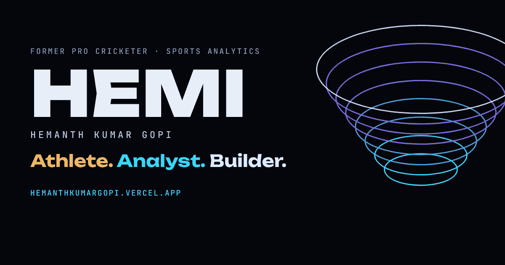

<div align="center">

# HEMANTH KUMAR GOPI
### Beyond the Game

**Athlete. Analyst. Builder.**

*Former professional cricketer, now building a career in sports analytics, machine learning and AI.*

[](https://hemanthkumargopi.vercel.app)
[](https://www.linkedin.com/in/hemanthkumargopi)
[](mailto:hemanthkumargopi55@gmail.com)

<a href="https://hemanthkumargopi.vercel.app">
  
</a>

**[→ Open the live experience](https://hemanthkumargopi.vercel.app)**

</div>

---

## About this project

This repository holds my personal portfolio: an interactive, cinematic website that tells the story of my move from professional cricket into sports analytics.

I spent seven years in competitive cricket. That included state-level cricket with the Tamil Nadu Cricket Association and the Tamil Nadu Premier League with Dindigul Dragons. I hold a B.E. in Computer Science, was selected for the 2026 MIT Sloan Sports Analytics Conference Mentorship Program, and am now pursuing an MS in Business Analytics at Suffolk University in Boston. The site is built the way I like to work: it starts with a story and is backed by data. Every visual on it is generated in code.

The site is more than a résumé. It has five parts:

- a scroll-driven story in five chapters
- a "project universe" of case studies
- a hands-on analytics playground
- a skills map
- a 20-second Recruiter view for people who just need the facts

---

## Highlights

| | Feature | What it does |
|---|---|---|
| ✨ | **Particle engine** | A custom canvas engine animates thousands of particles (2,600 on desktop and 1,300 on mobile) with spring physics and 3D perspective. They re-form into a new shape for every scene: a stadium, a pitch with a bat, a globe, a court, an American football, a network and more. |
| 🎬 | **Story chapters** | Five chapters: *The Athlete → The Question → The Transition → The Analyst → The Builder*, from Chennai to Boston. |
| 🎯 | **Two modes** | **Immersive** is the full cinematic experience. **Recruiter** is a clean summary you can read in 20 seconds. Both modes draw from the same content. |
| 🪐 | **Project universe** | Every project opens a structured case study: problem, data, approach, technology, results, limitations and next steps. |
| 🧪 | **Analytics playground** | Three live, interactive demos: an NBA explorer, cricket ball physics and a prediction demo. Each one says clearly when it uses demonstration data. |
| 🏏 | **Cricket ball physics** | The ball's flight is calculated live with real gravity (9.81 m/s²). It is not a pre-made animation. |
| ⌨️ | **Command menu** | Press `⌘K` / `Ctrl+K` to search sections, projects and demos, switch modes, toggle effects or copy my email. |
| ⚙️ | **"How this site works"** | A behind-the-scenes section that shows how the site runs, including a live frames-per-second counter for your device. |

---

## Built with

<div align="center">


</div>

- **No frameworks and no libraries.** The whole site is one `index.html` file of hand-written HTML, CSS and JavaScript. The only outside resource is the typography, loaded from Google Fonts.
- **No build step.** What you see in this repository is exactly what runs in the browser.
- **Shapes generated from math.** Every particle shape is calculated in code; the scenes use no image files.
- **Content kept apart from code.** All text lives in two config objects (`CONTENT` and `CASES`), so updating the site means editing words, not rewriting layout.
- **Error isolation.** Each module runs inside its own error boundary, so if one part fails, the rest of the page keeps working.

---

## Accessibility and performance

- Respects **`prefers-reduced-motion`**: animations calm down for visitors who ask for less motion.
- **Visual effects toggle** in the command menu. The site remembers the choice on that device.
- Full **keyboard navigation**, visible focus states, ARIA labels on interactive parts, and dialogs that return focus correctly.
- **Responsive** from small phones to large desktop screens. The particle count drops on mobile to keep the animation smooth.
- **Fast and lightweight:** one HTML file plus one share image, served from Vercel's global edge network.
- **Privacy-friendly:** no analytics trackers, ads or cookies.

---

## Repository structure

```
.
├── index.html   # The entire website: markup, styles, particle engine and content
├── og.png       # 1200×630 share card shown when the link is posted on LinkedIn and elsewhere
└── README.md    # You are here
```

---

## Run it locally

No setup is needed.

```bash
git clone https://github.com/Hemanth-55/Portfolio-Website.git
cd Portfolio-Website
open index.html          # macOS. On Windows use: start index.html
```

Or serve it locally:

```bash
python3 -m http.server 8000
# then visit http://localhost:8000
```

---

## Deployment

The site is hosted on **[Vercel](https://vercel.com)** and connected to this repository.

Every push to `main` deploys automatically to **[hemanthkumargopi.vercel.app](https://hemanthkumargopi.vercel.app)**, usually within a minute. There is no build step, so Vercel serves `index.html` exactly as committed.

---

## Updating content

All the site's text lives near the top of the script in `index.html`:

| Object | Holds |
|---|---|
| `CONTENT` | Headline, pitch, story chapters, experience, skills, interests and contact links |
| `CASES` | The case study details for each project |

Edit the text, commit, push, and the live site updates by itself.

---

## Let's connect

I'm looking for **internships and roles in sports analytics, sports technology and data science**, especially with NFL, NBA, MLB and NHL organizations or teams working on athlete performance.

- 🌐 **Website:** [hemanthkumargopi.vercel.app](https://hemanthkumargopi.vercel.app)
- 💼 **LinkedIn:** [linkedin.com/in/hemanthkumargopi](https://www.linkedin.com/in/hemanthkumargopi)
- 🐙 **GitHub:** [github.com/Hemanth-55](https://github.com/Hemanth-55)
- ✉️ **Email:** [hemanthkumargopi55@gmail.com](mailto:hemanthkumargopi55@gmail.com)

---

<div align="center">

*"Data didn't replace the work. It told me where to put it."*

© Hemanth Kumar Gopi. All rights reserved.
The design, written content and code in this repository are personal work and may not be reused without permission.

</div>
